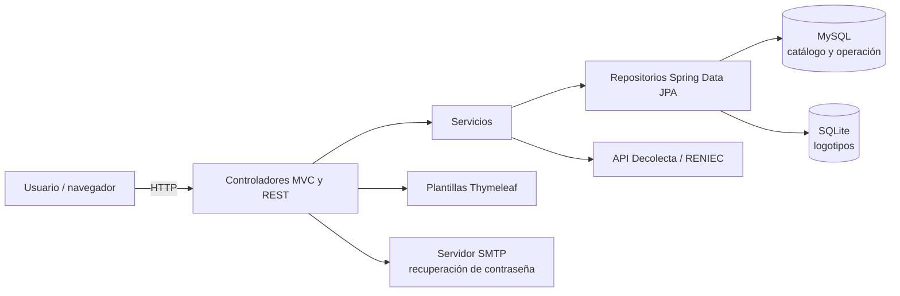

# Gestión de catálogo, inventario y ventas

Aplicación web desarrollada con Spring Boot para administrar un catálogo comercial, las operaciones de venta y los datos de una tienda. Incluye un catálogo público, un panel protegido y persistencia en MySQL y SQLite.


## Funcionalidades

- Catálogo público con productos, categorías, filtros y búsqueda de clientes.
- Gestión de productos, categorías, clientes, ventas, cuotas e inventario.
- Administración de usuarios, roles y permisos; contraseñas codificadas con BCrypt.
- Panel con datos de ventas mensuales y stock agrupado por categoría.
- Configuración de empresa, logotipos y sliders, con carga de imágenes.
- Consulta de DNI mediante la API externa de Decolecta/RENIEC.
- Recuperación de contraseña mediante correo SMTP.

## Tecnologías

| Área | Tecnología |
|---|---|
| Backend | Java 21, Spring Boot 3.4.1, Spring MVC |
| Vistas y seguridad | Thymeleaf, Spring Security 6 |
| Persistencia | Spring Data JPA, Hibernate, MySQL y SQLite |
| Interfaz | Plantillas HTML, JavaScript y recursos AdminLTE incluidos en el repositorio |
| Construcción | Maven Wrapper |

## Arquitectura

La aplicación usa controladores MVC para servir vistas y procesar formularios, junto con controladores REST para algunas consultas del catálogo y del panel. Los repositorios Spring Data JPA acceden a dos unidades de persistencia: MySQL para las entidades del negocio y SQLite para los logotipos.



## Estructura del proyecto

```text
.
├── pom.xml
├── mvnw / mvnw.cmd
├── bd_logos.db
├── img/                              # Imágenes de productos, empresa y sliders
└── src/
    ├── main/
    │   ├── java/com/example/proyecto/
    │   │   ├── config/               # Datasources, seguridad y configuración MVC
    │   │   ├── controller/           # Controladores MVC y endpoints REST
    │   │   ├── dto/                  # Objetos de transferencia para ventas
    │   │   ├── model/                # Entidades JPA
    │   │   ├── repository/           # Repositorios de datos
    │   │   ├── seguridad/            # Integración de usuarios con Spring Security
    │   │   └── service/              # Lógica de inventario, permisos y consultas externas
    │   └── resources/
    │       ├── application.properties
    │       ├── templates/             # Vistas Thymeleaf
    │       └── static/                # JavaScript y recursos web
    └── test/                          # Pruebas automatizadas
```

## Requisitos previos

- JDK 21.
- MySQL en ejecución y una base de datos llamada `bd_catalogo`.
- Acceso a Internet durante la primera compilación para que Maven Wrapper descargue Maven y las dependencias.
- (Opcional, para las funciones asociadas) token de Decolecta y credenciales de un servidor SMTP.

No se requiere instalar Maven globalmente: el repositorio incluye el wrapper para Windows y Unix.

## Configuración

La aplicación escucha en el puerto `8081`. Antes de iniciarla, configura las propiedades sensibles mediante variables de entorno o un archivo de configuración local que no se suba al repositorio. Spring Boot admite variables de entorno con el nombre en mayúsculas y puntos reemplazados por guiones bajos.

| Variable de entorno | Propiedad | Uso |
|---|---|---|
| `SPRING_DATASOURCE_URL` | `spring.datasource.url` | URL JDBC de MySQL; por defecto apunta a `bd_catalogo` en `localhost:3306` |
| `SPRING_DATASOURCE_USERNAME` | `spring.datasource.username` | Usuario de MySQL |
| `SPRING_DATASOURCE_PASSWORD` | `spring.datasource.password` | Contraseña de MySQL |
| `SPRING_DATASOURCE_SQLITE_URL` | `spring.datasource.sqlite.url` | URL del archivo SQLite de logotipos; por defecto `jdbc:sqlite:bd_logos.db` |
| `DECOLECTA_TOKEN` | `decolecta.token` | Token para la consulta de DNI |
| `SPRING_MAIL_USERNAME` | `spring.mail.username` | Cuenta SMTP para recuperación de contraseña |
| `SPRING_MAIL_PASSWORD` | `spring.mail.password` | Credencial SMTP o contraseña de aplicación |

El host y puerto SMTP se configuran con `SPRING_MAIL_HOST` y `SPRING_MAIL_PORT` si tu proveedor requiere valores distintos. Las propiedades de conexión a MySQL, token y SMTP tienen valores en `application.properties`; define los valores correctos en el entorno antes de usar la aplicación. El repositorio también contiene un archivo de base de datos SQLite; conserva una copia de seguridad antes de reemplazarlo o inicializar datos en un entorno con información existente.

En PowerShell, define las variables para la sesión actual antes de ejecutar la aplicación:

```powershell
$env:SPRING_DATASOURCE_URL = "jdbc:mysql://localhost:3306/bd_catalogo?useSSL=false&serverTimezone=UTC"
$env:SPRING_DATASOURCE_USERNAME = "<usuario>"
$env:SPRING_DATASOURCE_PASSWORD = "<contraseña>"
$env:SPRING_DATASOURCE_SQLITE_URL = "jdbc:sqlite:bd_logos.db"
$env:DECOLECTA_TOKEN = "<token>"
$env:SPRING_MAIL_USERNAME = "<cuenta SMTP>"
$env:SPRING_MAIL_PASSWORD = "<credencial SMTP>"
```

En Bash, exporta las mismas variables con `export NOMBRE=valor`. No guardes credenciales reales en el control de versiones.

## Instalación y ejecución

1. Clona el repositorio y entra en su directorio raíz.
2. Crea la base de datos MySQL `bd_catalogo` y configura sus credenciales.
3. Define las variables de entorno requeridas para las integraciones que vayas a utilizar.
4. Ejecuta la aplicación:

   **Windows (PowerShell):**

   ```powershell
   .\mvnw.cmd spring-boot:run
   ```

   **Linux/macOS:**

   ```bash
   ./mvnw spring-boot:run
   ```

5. Abre [http://localhost:8081](http://localhost:8081). La ruta raíz redirige al formulario de inicio de sesión.

Para construir el artefacto ejecutable:

```bash
./mvnw clean package
```

En Windows, usa `.\mvnw.cmd clean package`. El JAR se genera en `target/` y puede iniciarse con `java -jar target/proyecto-0.0.1-SNAPSHOT.jar`.

## Rutas principales

| Ruta | Descripción |
|---|---|
| `/` | Redirección a inicio de sesión |
| `/login` | Inicio de sesión |
| `/panel` | Panel administrativo (requiere autenticación) |
| `/web` | Catálogo público |
| `/productos`, `/categorias`, `/clientes`, `/ventas`, `/inventario` | Módulos de gestión |
| `/usuarios`, `/roles`, `/permisos` | Administración de acceso |
| `/configuracion` | Configuración de empresa, logotipos y sliders |
| `/api/web/productos/filtrar` | Filtrado REST del catálogo |
| `/api/dashboard/grafico-categorias` | Datos de stock por categoría |
| `/api/dashboard/grafico-ventas` | Datos históricos de ventas mensuales |

Las rutas de gestión requieren iniciar sesión, excepto las que la configuración de Spring Security permite explícitamente. El acceso a secciones del panel se representa mediante permisos asociados a roles.

## Pruebas

El proyecto incluye una prueba de carga del contexto Spring Boot. Para ejecutarla:

```bash
./mvnw test
```

La configuración de prueba usa los datasources definidos en la aplicación, por lo que MySQL debe estar disponible y configurado para que el contexto pueda iniciar.

## Notas de datos

- Hibernate está configurado con `ddl-auto=update`; al iniciar puede crear o actualizar tablas.
- SQLite se configura mediante `spring.datasource.sqlite.url`; el archivo incluido `bd_logos.db` se usa por defecto.
- El inicializador crea permisos y un rol administrador cuando faltan, y crea un usuario inicial si no existe. Revisa y cambia las credenciales iniciales antes de exponer la aplicación.
- Las imágenes cargadas se sirven desde la carpeta `img/` del directorio de ejecución.
